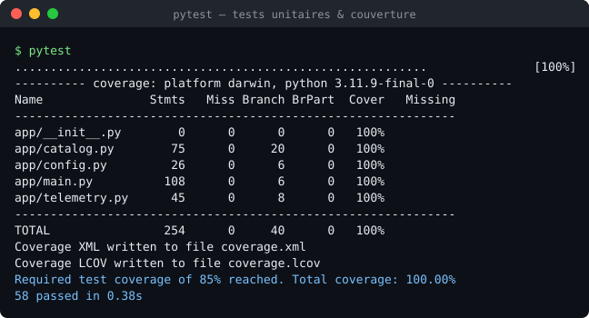
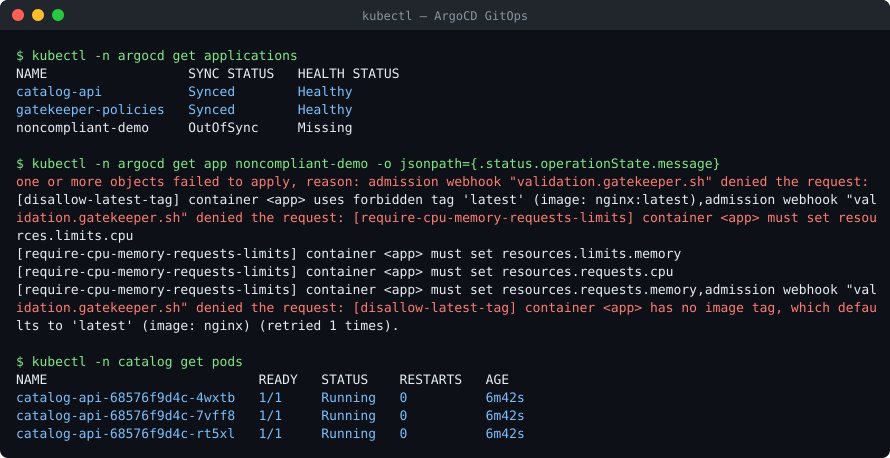
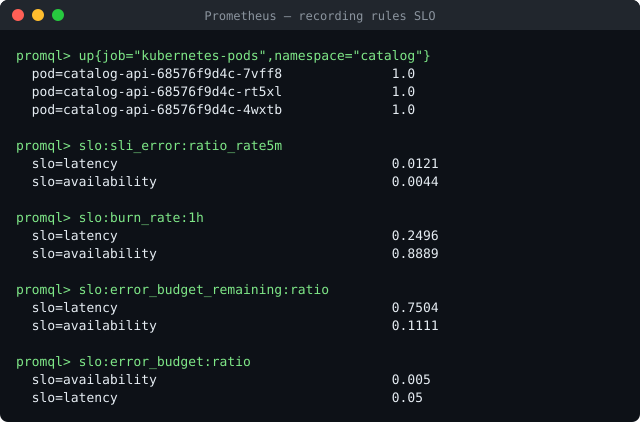
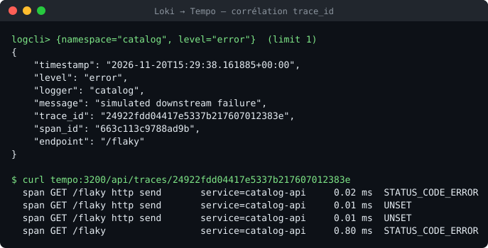
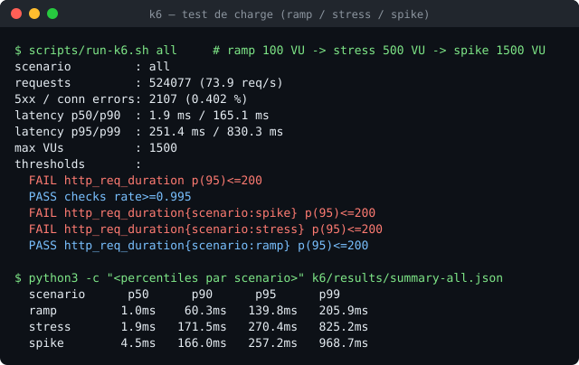
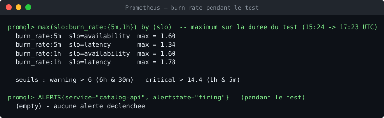

<p align="center">
  
</p>

<h1 align="center">TP 4 : Continuous Delivery, Quality &amp; Security Gates et Ingénierie SRE</h1>
<h3 align="center">Compte rendu — Pipeline CI/CD sécurisé, GitOps avec OPA Gatekeeper, observabilité OpenTelemetry et Error Budget</h3>

<p align="center">
  <b>Réalisé par :</b><br>
  Youssef Khalifa<br>
  Hanine Khemir<br>
  Oussema Said<br>
  Ahmed Amine Bououd
</p>

<p align="center">
  <b>Classe :</b> GL4 — Groupe 1
</p>

<div class="pagebreak"></div>

---

**Dépôt :** https://github.com/HanineKhemir/devops-sre-lab

**Application :** `catalog-api`, un microservice REST de catalogue produit (Python 3.12, FastAPI) avec un endpoint lent (`/checkout`) et un endpoint à erreurs intermittentes (`/flaky`).

**Outils :** pytest, SonarCloud, Trivy 0.76.2, GitHub Actions, kind (Kubernetes v1.36.1), Helm 4, ArgoCD 3.6, OPA Gatekeeper 3.23, OpenTelemetry SDK 1.29, kube-prometheus-stack 93.6 (Prometheus, Alertmanager, Grafana), Loki 3.6, Tempo 2.9, Grafana Alloy 1.22, k6 1.4

**Preuves :** toutes les sorties citées dans ce rapport sont dans le dossier [`docs/captures/`](captures/), et les résultats k6 bruts dans `k6/results/`.

**Figures :** les captures « terminal » sont les sorties réelles des commandes, enregistrées en `.txt` puis mises en forme par [`scripts/term2svg.py`](../scripts/term2svg.py) (couleurs ajoutées, texte inchangé ; `...` marque une coupure).

---

## 1. Le problème

Aux TP précédents, nous avons sécurisé le code, les dépendances, l'image et l'exécution. Ce TP traite la **livraison** et l'**exploitation** : comment être sûr que seul du code de qualité arrive en production, que le cluster refuse ce qui n'est pas conforme, et que l'on sait **mesurer** si le service tient ses promesses.

| Question | Partie du TP |
|---|---|
| Le code est-il testé et assez couvert pour être livré ? | 2. Microservice & tests |
| Qui bloque un code de mauvaise qualité ou un manifeste dangereux ? | 3. Quality Gate & Gatekeeper |
| Comment passe-t-on d'un commit à un déploiement sans intervention manuelle ? | 4. CI/CD & GitOps |
| Quand une requête échoue, peut-on suivre son chemin (métriques, logs, trace) ? | 5. Observabilité |
| Le service respecte-t-il son contrat, et que se passe-t-il sous forte charge ? | 6. SRE |

---

## 2. Microservice & couverture de tests

### 2.1 L'application

| Endpoint | Rôle |
|---|---|
| `GET /products`, `GET /products/{id}`, `POST /products` | Catalogue : pagination, validation des entrées |
| `POST /checkout` | Paiement simulé lent (20 à 220 ms, configurable) + décrément **atomique** du stock |
| `GET /flaky` | Renvoie une erreur 500 dans 5 % des cas (`FLAKY_ERROR_RATE`) |
| `GET /metrics` | Métriques au format Prometheus (exporter OpenTelemetry) |
| `GET /health` | Sondes liveness / readiness Kubernetes |

Le délai et le taux d'erreur sont lus dans les variables d'environnement. Dans les tests, l'aléa (`random`) et le `sleep` sont **injectés** dans `create_app()`, ce qui rend `/flaky` et `/checkout` déterministes.

### 2.2 Tests unitaires et cas limites

58 tests (`tests/`) couvrent les cas nominaux et les cas limites suivants :

* stock exact puis épuisé (409), produit inconnu (404) ;
* panier vide, quantité 0, négative ou supérieure à 1000 (422) ;
* **atomicité** du checkout : une ligne invalide n'applique aucune ligne du panier ;
* prix à 3 décimales, nom vide après `strip()`, pagination hors bornes ;
* `/flaky` aux bornes 0 et 1, et comparaison stricte `<` au seuil exact ;
* variables d'environnement invalides, exception non gérée (500) ;
* format JSON des logs avec et sans span actif.

<p align="center"><br><em>Figure 1 — pytest : 58 tests réussis, couverture lignes + branches de 100 % (rapports Cobertura et LCOV générés)</em></p>

**Critère de validation :** `--cov-fail-under=85` (`pyproject.toml`) fait échouer pytest, et donc la CI, sous 85 %. Résultat : **100 %**.

---

## 3. Quality Gate SonarQube & Policy Enforcement

### 3.1 Quality Gate SonarCloud

`sonar-project.properties` déclare les sources, les tests et le rapport de couverture `coverage.xml`. L'option `sonar.qualitygate.wait=true` fait **échouer le scanner** quand la gate est rouge, ce qui bloque le job et donc la suite du pipeline.

| Condition sur le nouveau code | Bloque si |
|---|---|
| Coverage on New Code | < 85 % |
| Security Hotspots | au moins 1 hotspot non revu |
| Duplicated Lines on New Code | > 3 % |

L'offre gratuite de SonarCloud impose la gate « Sonar way » (80 % de couverture). Pour appliquer **exactement** les seuils du sujet, le script [`scripts/check_quality_gate.py`](../scripts/check_quality_gate.py) relit les mesures via l'API Sonar (`/api/measures/component`) et fait échouer la CI sur ces trois conditions.

> **Reste à faire :** la capture d'une PR bloquée par la Quality Gate sera ajoutée après l'activation du projet SonarCloud et l'ajout du secret `SONAR_TOKEN` au dépôt. En attendant, le job Sonar échoue à chaque push, ce qui bloque bien le build et le déploiement.

### 3.2 OPA Gatekeeper

Deux `ConstraintTemplate` écrits en Rego (`policies/templates/`) :

| Contrainte | Règle | Détails |
|---|---|---|
| `K8sDisallowLatestTag` | Interdit le tag `latest` | Refuse aussi les images **sans tag** (Kubernetes les résout en `latest`). Accepte les registres avec port (`localhost:5000/app:1.0`) et les digests (`@sha256:`). Vérifie `containers`, `initContainers` et `ephemeralContainers`. |
| `K8sRequiredResources` | `requests` et `limits` CPU **et** mémoire obligatoires | Liste des ressources paramétrable dans la contrainte. |

Deux choix de conception :

1. Les contraintes ciblent les **Pods et les workloads** (`Deployment`, `StatefulSet`, `DaemonSet`, `ReplicaSet`, `Job`, `CronJob`). Si elles ne ciblaient que les Pods, `kubectl apply` d'un Deployment réussirait, et l'échec n'apparaîtrait que plus tard, silencieusement, au niveau du ReplicaSet.
2. Elles sont limitées au namespace `catalog`, pour ne pas bloquer les charts de la plateforme (ArgoCD, Prometheus…) qui ne sont pas sous notre contrôle.

<p align="center"><br><em>Figure 2 — Gatekeeper : refus de l'image <code>:latest</code>, de l'image sans tag et du pod sans requests/limits ; le manifeste conforme est accepté</em></p>

---

## 4. Pipeline CI/CD & déploiement continu (GitOps)

### 4.1 Pipeline GitHub Actions

Fichier : [`.github/workflows/ci.yml`](../.github/workflows/ci.yml)

| # | Job | Bloque si | Détails |
|---|---|---|---|
| 1 | Lint & Test | erreur `ruff`, test en échec, couverture < 85 % | Publie `coverage.xml` comme artefact |
| 2 | SonarQube Analysis & Quality Gate | Quality Gate rouge | Historique Git complet (`fetch-depth: 0`) pour détecter le nouveau code |
| 3 | Build | — | Image construite **localement** (`load: true`), taguée `sha-<commit>` et jamais `latest` |
| 4 | Trivy | au moins une vulnérabilité **CRITICAL** | `--severity CRITICAL --exit-code 1` ; rapport SARIF complet dans l'onglet *Security* |
| 5 | Push GHCR | — | Uniquement sur `main`, et seulement si Trivy est passé |
| 6 | GitOps bump | — | Écrit le nouveau tag dans `values.yaml` et le commite (`[skip ci]`) ; ArgoCD déploie |

**Gestion des secrets :**

* `SONAR_TOKEN` est un secret GitHub.
* Le push vers GHCR utilise le `GITHUB_TOKEN` éphémère, avec `packages: write` sur ce seul job ; les autres jobs n'ont que `contents: read`.
* Dans le cluster, le mot de passe Grafana et les URLs des webhooks Alertmanager sont des `Secret` Kubernetes, jamais commités.

<p align="center"><br><em>Figure 3 — Trivy sur l'image <code>catalog-api</code> : 0 vulnérabilité CRITICAL, code de sortie 0, donc le push est autorisé</em></p>

### 4.2 Déploiement continu avec ArgoCD

* Chart Helm [`deploy/helm/catalog-api`](../deploy/helm/catalog-api) : Deployment de 3 réplicas (non-root, système de fichiers en lecture seule, capacités supprimées), Service NodePort, PodDisruptionBudget, `PrometheusRule` des SLO et dashboard Grafana.
* Application ArgoCD [`catalog-api`](../deploy/argocd/catalog-api.yaml) : synchronisation automatique, avec `prune` et `selfHeal`.
* Application [`gatekeeper-policies`](../deploy/argocd/gatekeeper-policies.yaml) : les politiques Rego sont elles aussi versionnées et déployées par GitOps.

**Test de rejet.** L'application [`noncompliant-demo`](../deploy/argocd/demo/noncompliant-app.yaml) pointe vers les manifestes non conformes `policies/tests/bad-*.yaml`. ArgoCD tente de les synchroniser, et l'API Server les refuse via le webhook Gatekeeper :

<p align="center"><br><em>Figure 4 — ArgoCD : <code>catalog-api</code> et les politiques sont synchronisés ; la synchronisation de <code>noncompliant-demo</code> est rejetée par Gatekeeper au niveau de l'API Server</em></p>

---

## 5. Instrumentation & stack d'observabilité

### 5.1 OpenTelemetry dans le microservice

Fichier : [`app/telemetry.py`](../app/telemetry.py)

| Signal | Implémentation | Destination |
|---|---|---|
| Traces | `TracerProvider` + `FastAPIInstrumentor` + span manuel `payment.authorize` dans `/checkout` | OTLP gRPC → **Tempo** |
| Métriques | `MeterProvider` + `PrometheusMetricReader`, histogramme `http.server.request.duration` | `/metrics` → **Prometheus** |
| Logs | `JsonFormatter` : chaque ligne JSON contient le `trace_id` et le `span_id` du span courant | stdout → Alloy → **Loki** |

Trois choix importants :

1. **Buckets explicites contenant 0,2 s.** C'est la borne du SLO de latence. Avec les buckets par défaut, la part de requêtes sous 200 ms ne pourrait être qu'estimée ; avec cette borne, elle est **exacte**.
2. **Labels à faible cardinalité.** La route est enregistrée au format template (`/products/{product_id}`), pas avec l'identifiant réel. Les métriques automatiques de l'instrumentation FastAPI (labels `http_host`, `net_host_port`…) sont désactivées.
3. **Un worker uvicorn par pod.** Chaque processus a son propre registre de métriques, et Prometheus ne scrape qu'un processus par pod. On monte donc en charge par réplicas.

### 5.2 La stack

* **Prometheus :** un `additionalScrapeConfigs` en rôle `pod` garde les pods annotés `prometheus.io/scrape: "true"` et lit les annotations `prometheus.io/port` et `prometheus.io/path`.
* **Loki** (single binary) reçoit les logs de **Grafana Alloy**. Alloy lit les logs du namespace `catalog`, transforme `level` en label et garde `trace_id` en *structured metadata* (pas de label à forte cardinalité).
* **Tempo** reçoit les traces en OTLP gRPC (port 4317).
* **Grafana :** la datasource Loki a un *derived field* `trace_id` qui ouvre la trace dans Tempo, et la datasource Tempo a le *traces-to-logs* vers Loki. On navigue ainsi dans les deux sens entre logs et traces.

<p align="center"><br><em>Figure 5 — Prometheus : les 3 pods sont découverts par annotation ; les recording rules SLI, burn rate et budget sont calculées</em></p>

<p align="center"><br><em>Figure 6 — Corrélation Logs ↔ Traces : une ligne d'erreur JSON dans Loki, puis la trace de même <code>trace_id</code> dans Tempo (span en erreur)</em></p>

---

## 6. Ingénierie SRE, performance & Error Budget

### 6.1 Contrat de service (SLI / SLO)

| SLO | SLI (PromQL) | Objectif | Error budget |
|---|---|---|---|
| Disponibilité | `sum(rate(…_count{code=~"5.."}[w])) / sum(rate(…_count[w]))` | 99,5 % de requêtes avec statut < 500 | **0,5 %** |
| Latence | `1 - sum(rate(…_bucket{le="0.2"}[w])) / sum(rate(…_count[w]))` | 95 % des requêtes en < 200 ms (p95 ≤ 200 ms) | **5 %** |

* **Fenêtre glissante :** 30 jours.
* **Recording rules :** les ratios sont pré-calculés pour 5m, 30m, 1h, 6h, 1d, 3d et 30d (`slo:sli_error:ratio_rate<w>`), dans [`prometheusrule.yaml`](../deploy/helm/catalog-api/templates/prometheusrule.yaml).

### 6.2 Calcul de l'Error Budget

```
error budget            = 1 − objectif SLO                    → 0,005 (dispo) / 0,05 (latence)
burn rate (fenêtre w)   = taux d'erreur observé sur w / error budget
budget restant          = 1 − taux d'erreur sur 30 j / error budget
budget consommé en T    = burn rate × T / 30 j
```

**Exemple (disponibilité) :**

* Un budget de 0,5 % sur 30 jours équivaut à **3 h 36 min** d'indisponibilité totale.
* Pour 1 000 000 de requêtes par mois, **5 000** réponses 5xx sont tolérées.
* Un burn rate de 1 consomme exactement le budget en 30 jours.

### 6.3 Alerting multi-window multi-burn-rate

| Alerte | Condition | Budget consommé | Routage Alertmanager |
|---|---|---|---|
| **Critical** (page) | burn rate **1h > 14,4** ET **5m > 14,4** | 14,4 × 1 h / 720 h = **2 % en 1 h** | `severity=critical` → receiver `pager` |
| **Warning** (Slack) | burn rate **6h > 6** ET **30m > 6** | 6 × 6 h / 720 h = **5 % en 6 h** | `severity=warning` → receiver `slack` |

* **Rôle des deux fenêtres :** la fenêtre longue évite les fausses alertes sur un pic bref. La fenêtre courte fait retomber l'alerte dès que l'incident est résolu.
* **Inhibition :** une `inhibit_rule` coupe le warning tant que le critical du même SLO est actif.
* Les quatre alertes (deux par SLO) ont un `runbook_url` vers [`docs/runbook.md`](runbook.md).
* **Receivers en local :** ils pointent vers `alert-sink`, un petit service qui journalise chaque notification reçue. Pour notifier un vrai canal, il suffit de mettre l'URL Slack dans le secret `alertmanager-receivers`.

### 6.4 Dashboard Grafana (méthode RED)

Le dashboard *Catalog API — SRE (RED + Error Budget)* est provisionné automatiquement par ConfigMap (sidecar Grafana). Il contient :

| Panneau | Requête |
|---|---|
| **Rate** | RPS total et par route |
| **Errors** | 5xx/s par route et % d'erreur global, avec une ligne de seuil à 0,5 % |
| **Duration** | p50 / p90 / p95 / p99 (`histogram_quantile`) avec une ligne à 200 ms, et p95 par route |
| **Error Budget Remaining** | Jauges disponibilité et latence (`slo:error_budget_remaining:ratio`) et SLI sur 30 j |
| **Burn rate** | 5m / 30m / 1h / 6h avec les seuils 6 et 14,4, et annotations des alertes |
| Logs | Logs d'erreur Loki (clic sur `trace_id` → Tempo) |

### 6.5 Test de charge k6

Fichier : [`k6/load-test.js`](../k6/load-test.js), lancé par [`scripts/run-k6.sh`](../scripts/run-k6.sh). k6 tourne dans un conteneur sur le réseau Docker de kind, ce qui évite le goulot d'étranglement d'un `kubectl port-forward`.

| Scénario | Profil |
|---|---|
| Ramp-up | 0 → 100 VU en 2 min, palier de 3 min |
| Stress | 0 → 500 VU en 2 min, palier de **10 min** |
| Spike | 0 → **1500 VU en 5 s**, maintenu **30 s** |

* **Mix de trafic :** 55 % liste, 25 % détail, 12 % checkout, 8 % `/flaky`.
* **Seuils k6 = SLO :**
  * `checks rate ≥ 0.995` (aucun 5xx et aucune requête sans réponse) ;
  * `p(95) ≤ 200 ms`, au global et pour chaque scénario.

<p align="center"><br><em>Figure 7 — Résultats k6 : 524 077 requêtes ; le SLO de disponibilité tient (0,40 % d'erreurs), le SLO de latence est violé en stress et en spike</em></p>

### 6.6 Analyse de l'incident

**Ce qui s'est passé.**

| Scénario | p95 | p99 | SLO latence |
|---|---|---|---|
| Ramp-up (100 VU) | 139,8 ms | 205,9 ms | respecté |
| Stress (500 VU) | 270,4 ms | 825,2 ms | **violé** |
| Spike (1500 VU) | 257,2 ms | 968,7 ms | **violé** |

* Avec 3 pods limités à 1 vCPU et un seul worker Python chacun, le service **sature en CPU** au-delà de quelques centaines de VU : les requêtes font la queue, et la queue de distribution (p95, p99) explose.
* La médiane reste faible (1,9 ms en stress), car la plupart des requêtes `GET /products` sont servies avant la saturation.
* La disponibilité tient : 2 107 erreurs sur 524 077 requêtes, soit **0,40 %**, sous le budget de 0,5 %. Ce sont surtout les 5 % d'erreurs de `/flaky`, plus quelques connexions refusées pendant le spike.

<p align="center"><br><em>Figure 8 — Burn rate maximum pendant le test : 1,6 (disponibilité) et 1,8 (latence), loin des seuils 6 et 14,4 ; aucune alerte déclenchée</em></p>

**Pourquoi aucune alerte n'a été déclenchée.** C'est le comportement attendu de la méthode multi-burn-rate :

* Le SLO de latence porte sur **toutes** les requêtes : le budget de 5 % n'est consommé que par les requêtes au-dessus de 200 ms.
* Même en stress, environ 90 % des requêtes restaient sous 200 ms (p90 ≈ 170 ms). Le taux de « mauvaises » requêtes est donc resté autour de 6 à 9 %, soit un burn rate de 1,3 à 1,8.
* À ce rythme, le budget mensuel serait épuisé en 17 à 23 jours : c'est sérieux, mais ce n'est **pas** une urgence qui justifie de réveiller quelqu'un. Une violation du p95 pendant quelques minutes n'est pas un incident de production.
* Les seuils 6 et 14,4 sont faits pour alerter quand une part importante du budget est consommée en quelques heures, pas pour réagir à un test de charge de 20 minutes.

**Remarque sur la durée du test.** Le test a duré 1 h 58 au lieu des 21 minutes prévues, et une requête du scénario stress est restée bloquée plus d'une heure (max = 3 931 s). Cela correspond très probablement à une mise en veille du poste ou à une pause de Docker Desktop pendant le test ; les percentiles p50 à p99 ne sont pas affectés par cette requête isolée.

**Actions correctives proposées :**

| Problème | Action |
|---|---|
| Saturation CPU sous 500 VU | HorizontalPodAutoscaler sur le CPU (3 à 10 réplicas) + metrics-server |
| Un seul worker par pod | Plusieurs workers avec un registre Prometheus multi-processus |
| Requêtes `GET /products` répétitives | Cache (HTTP `Cache-Control` ou Redis) |
| Requêtes qui attendent indéfiniment | Timeout côté serveur et limite de concurrence (load shedding : répondre vite par un 503 plutôt que laisser la requête attendre) |

> **Suite du TP :** pour valider de bout en bout la chaîne d'alerte, nous injecterons une panne volontaire par GitOps (`FLAKY_ERROR_RATE=0.5` et limite CPU réduite) pendant un scénario de stress, afin de déclencher les alertes Warning et Critical, puis nous annulerons le commit et observerons leur résolution.

---

## 7. Bilan

| Couche | Mécanisme | Résultat |
|---|---|---|
| Code | pytest + `--cov-fail-under=85` | 58 tests, **100 %** de couverture |
| Qualité | SonarCloud `qualitygate.wait` + seuils du sujet vérifiés par API | Pipeline bloqué si la gate est rouge |
| Image | Trivy `--severity CRITICAL --exit-code 1` avant tout push | **0 CRITICAL** ; image non-root, tag = SHA du commit |
| Cluster | Gatekeeper : `latest` interdit, requests/limits obligatoires | Manifestes non conformes **refusés par l'API Server**, y compris via ArgoCD |
| Livraison | GitHub Actions → GHCR → commit GitOps → ArgoCD | Aucun `kubectl` manuel pour déployer |
| Observabilité | OpenTelemetry → Prometheus / Loki / Tempo → Grafana | Logs et traces corrélés par `trace_id` |
| SRE | SLO 99,5 % et p95 ≤ 200 ms, burn rate 14,4 / 6 | Violation de la latence mesurée sous charge ; budget suivi en continu |

Chaque porte arrête une catégorie de problème différente :

* les **tests et la Quality Gate** arrêtent le mauvais code ;
* **Trivy** arrête les images vulnérables ;
* **Gatekeeper** arrête les déploiements dangereux, même s'ils contournent la CI ;
* les **SLO** disent, une fois en production, si le service tient sa promesse et à quel rythme on consomme la marge d'erreur.

**Pistes d'amélioration :**

* HPA et tests de charge automatisés dans la CI, sur un environnement de préproduction ;
* signature des images (cosign) et contrainte Gatekeeper n'acceptant que des images signées ;
* Argo Rollouts pour un déploiement *canary* piloté par le burn rate ;
* Tempo *metrics-generator* pour le graphe de services.

---

## Annexe : reproduire le TP

```bash
kind create cluster --config deploy/kind/cluster.yaml
docker build -t ghcr.io/haninekhemir/catalog-api:0.1.0-local .
kind load docker-image ghcr.io/haninekhemir/catalog-api:0.1.0-local --name sre-lab

# Plateforme
helm install gatekeeper gatekeeper/gatekeeper --version 3.23.1 -n gatekeeper-system --create-namespace
helm install argocd argo/argo-cd --version 10.18.2 -n argocd --create-namespace -f deploy/platform/argocd-values.yaml

# Observabilité (créer d'abord les secrets grafana-admin et alertmanager-receivers dans monitoring)
helm install kps prometheus-community/kube-prometheus-stack --version 93.6.0 -n monitoring \
  -f deploy/observability/kube-prometheus-stack-values.yaml
helm install loki  grafana/loki  --version 7.7.0  -n observability --create-namespace -f deploy/observability/loki-values.yaml
helm install tempo grafana/tempo --version 1.24.4 -n observability -f deploy/observability/tempo-values.yaml
helm install alloy grafana/alloy --version 1.16.0 -n observability -f deploy/observability/alloy-values.yaml
kubectl apply -f deploy/observability/alert-sink.yaml

# GitOps (application + politiques)
kubectl apply -f deploy/argocd/
kubectl apply -f deploy/argocd/demo/noncompliant-app.yaml     # démonstration du rejet

# Charge
scripts/run-k6.sh all        # ou : ramp | stress | spike
```

Accès : API http://localhost:30080 · Grafana http://localhost:30300 · Prometheus http://localhost:30090 · Alertmanager http://localhost:30093 · ArgoCD http://localhost:30443
