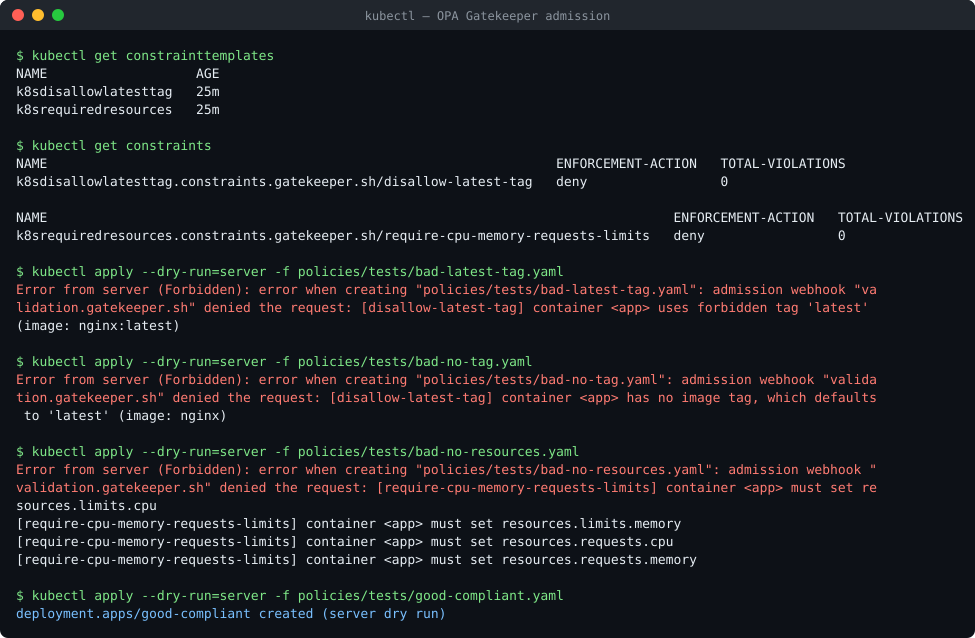
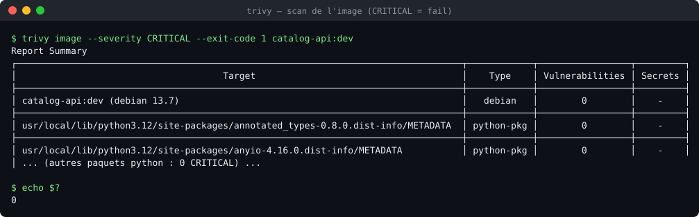

# Rapport SRE — Continuous Delivery, Quality & Security Gates, Observabilité Cloud-Native

**Dépôt :** https://github.com/HanineKhemir/devops-sre-lab
**Auteur :** Hanine Khemir — INSAT
**Environnement :** cluster Kubernetes local `kind` (v1.36), ArgoCD 3.6, OPA Gatekeeper 3.23, kube-prometheus-stack 93.6, Loki 3.6, Tempo 2.9, Grafana Alloy 1.22, k6 1.4

> Toutes les captures de ce rapport sont des sorties réelles de terminal, capturées sur le
> cluster du TP (`docs/captures/*.txt`) puis rendues en image (`scripts/term2svg.py`).
> Les sections marquées **⏳ En cours** seront complétées lors de la prochaine séance.

---

## 0. Avancement

| Étape | Livrable | Statut |
|---|---|---|
| 1 | Microservice FastAPI + `/metrics`, `/checkout` (lent), `/flaky` (erreurs) | ✅ |
| 1 | Tests pytest, rapport Cobertura (`coverage.xml`) + LCOV, couverture ≥ 85 % | ✅ 100 % |
| 2 | Quality Gate SonarCloud bloquante dans la CI | ✅ configurée — ⏳ capture PR en échec |
| 2 | Gatekeeper : 2 ConstraintTemplates Rego (`latest` interdit, requests/limits) | ✅ vérifié |
| 3 | Pipeline CI : Lint & Test → Sonar → Build → Trivy → Push → bump GitOps | ✅ écrite — ⏳ secret `SONAR_TOKEN` |
| 3 | ArgoCD (Helm) + rejet d'un manifeste non conforme | ✅ vérifié |
| 4 | OpenTelemetry (traces + logs JSON + métriques), Prometheus, Loki, Tempo, corrélation `trace_id` | ✅ vérifié |
| 5 | SLI/SLO, règles burn rate multi-fenêtres, Alertmanager, dashboard RED | ✅ déployés |
| 5 | Test de charge k6 (ramp 100 / stress 500 / spike 1500 VU) + analyse d'incident | ⏳ En cours |

---

## 1. Architecture

```
 Développeur ── PR ──► GitHub Actions ─────────────────────────────────────────────┐
                        Lint&Test ► SonarCloud QG ► Build ► Trivy ► Push GHCR      │
                                                                  │                ▼
                                                     bump tag dans values.yaml (Git)
                                                                                    │
  kind cluster ◄──────────────── ArgoCD (sync auto) ◄───────────────────────────────┘
   │   ▲ admission : OPA Gatekeeper (latest interdit, requests/limits obligatoires)
   │
   ├─ ns catalog        catalog-api ×3  (FastAPI + SDK OpenTelemetry)
   │                       ├─ /metrics ──scrape (annotations)──► Prometheus ─► Alertmanager ─► pager / slack
   │                       ├─ traces OTLP gRPC ────────────────► Tempo  ┐
   │                       └─ logs JSON stdout ─► Alloy ─────────► Loki   ├─► Grafana (dashboard RED + SLO)
   └─ k6 (conteneur sur le réseau kind) ─► NodePort 30080                ┘
```

| Composant | Fichiers |
|---|---|
| Application | `app/main.py`, `app/catalog.py`, `app/telemetry.py`, `app/config.py` |
| Tests | `tests/` (58 tests) |
| Image | `Dockerfile` (multi-stage, utilisateur non-root UID 10001) |
| CI | `.github/workflows/ci.yml`, `sonar-project.properties`, `scripts/check_quality_gate.py` |
| Politiques | `policies/templates/*.yaml` (Rego), `policies/constraints/*.yaml`, `policies/tests/` |
| GitOps | `deploy/helm/catalog-api/`, `deploy/argocd/` |
| Observabilité | `deploy/observability/*-values.yaml` |
| SRE | `deploy/helm/catalog-api/templates/prometheusrule.yaml`, `deploy/helm/catalog-api/dashboards/catalog-sre.json`, `k6/load-test.js` |

---

## 2. Étape 1 — Microservice & couverture de tests

API REST de catalogue produit (FastAPI) :

| Endpoint | Rôle |
|---|---|
| `GET /products`, `GET /products/{id}`, `POST /products` | Catalogue (pagination, validation) |
| `POST /checkout` | Traitement lent simulé (`CHECKOUT_DELAY_MIN_MS`..`MAX_MS`, défaut 20–220 ms) + décrément atomique du stock |
| `GET /flaky` | Erreur 500 intermittente (`FLAKY_ERROR_RATE`, défaut 5 %) |
| `GET /metrics` | Format Prometheus (exporter OpenTelemetry) |
| `GET /health` | Sondes liveness / readiness |

**Cas limites testés :** stock exact puis épuisé, panier vide, quantité 0/négative/> 1000, produit inconnu,
atomicité du checkout (une ligne invalide n'applique aucune ligne), prix à 3 décimales, nom vide après
`strip()`, pagination hors bornes, taux d'erreur aux bornes 0 et 1 et comparaison stricte `<`,
variables d'environnement invalides, exception non gérée → 500, format JSON des logs avec et sans span.

L'aléa (`random`) et le `sleep` sont injectés dans `create_app()`, ce qui rend `/flaky` et `/checkout`
déterministes en test.


Critère de validation : `--cov-fail-under=85` dans `pyproject.toml`. **Résultat : 100 % (lignes + branches).**

---

## 3. Étape 2 — Contrats de qualité & Policy Enforcement

### 3.1 Quality Gate SonarQube (SonarCloud)

* `sonar-project.properties` : sources `app/`, tests `tests/`, couverture `coverage.xml` (Cobertura),
  `sonar.qualitygate.wait=true` → le scanner **échoue** si la gate est rouge, ce qui bloque le job.
* Seuils exigés par le sujet, sur le **nouveau code** :

| Condition | Seuil |
|---|---|
| Coverage on New Code | < 85 % → échec |
| Security Hotspots Reviewed | < 100 % (au moins 1 hotspot non revu) → échec |
| Duplicated Lines on New Code | > 3 % → échec |

* En complément, `scripts/check_quality_gate.py` interroge l'API Sonar (`/api/measures/component`)
  et fait échouer la CI sur ces trois mêmes seuils, même si l'organisation SonarCloud ne permet pas
  de personnaliser la gate (offre gratuite = « Sonar way »).

**⏳ Capture à ajouter :** PR non conforme (par ex. une fonction non testée + un `subprocess` avec `shell=True`)
→ check « SonarQube Analysis & Quality Gate » rouge sur la PR.
Pré-requis : créer le projet sur sonarcloud.io, désactiver l'« Automatic Analysis », ajouter le secret
`SONAR_TOKEN` au dépôt.

### 3.2 OPA Gatekeeper

Deux `ConstraintTemplate` écrits en Rego (`policies/templates/`) :

1. **`K8sDisallowLatestTag`** : refuse `:latest` **et** les images sans tag (que Kubernetes résout en
   `latest`). Gère les registres avec port (`localhost:5000/app:1.0`) et autorise les digests (`@sha256:`).
   Couvre `containers`, `initContainers`, `ephemeralContainers`.
2. **`K8sRequiredResources`** : exige `requests.cpu`, `requests.memory`, `limits.cpu`, `limits.memory`
   sur chaque conteneur (paramétrable).

Les contraintes ciblent les objets `Pod` **et** les workloads (`Deployment`, `StatefulSet`,
`DaemonSet`, `ReplicaSet`, `Job`, `CronJob`) : le rejet a lieu au moment du `kubectl apply` ou de la
synchro ArgoCD, et non plus tard au niveau du ReplicaSet. Elles sont limitées au namespace `catalog`
pour ne pas bloquer les charts de la plateforme.



---

## 4. Étape 3 — Pipeline CI/CD & GitOps

### 4.1 Pipeline GitHub Actions (`.github/workflows/ci.yml`)

```
Lint & Test ──► SonarQube Analysis & Quality Gate ──► Build ► Trivy (CRITICAL = fail) ► Push GHCR ──► GitOps bump
 ruff, pytest     scan + qualitygate.wait=true          image taguée sha-<commit>         (push main)   values.yaml
 cov ≥ 85 %       + check_quality_gate.py               jamais "latest"                                 [skip ci]
```

* **Gestion des secrets** : `SONAR_TOKEN` en secret GitHub, push GHCR avec le `GITHUB_TOKEN` éphémère
  (permission `packages: write` sur ce job seulement), permissions par défaut `contents: read`.
  Côté cluster : mot de passe Grafana et URLs des webhooks Alertmanager dans des `Secret` Kubernetes,
  jamais dans Git.
* **Trivy** : l'image est construite localement (`load: true`), scannée, et poussée **seulement si**
  aucune vulnérabilité CRITICAL n'est trouvée. Un rapport SARIF (toutes sévérités) est publié dans
  l'onglet *Security* de GitHub.
* Sur une PR, la chaîne s'exécute jusqu'au scan Trivy sans pousser l'image.



### 4.2 Déploiement continu avec ArgoCD

* Chart Helm `deploy/helm/catalog-api` (Deployment ×3, Service NodePort, PDB, PrometheusRule, dashboard).
* `deploy/argocd/catalog-api.yaml` : sync automatique, `prune` + `selfHeal`.
* `deploy/argocd/gatekeeper-policies.yaml` : les politiques sont elles aussi versionnées et synchronisées.
* **Test de rejet** : `deploy/argocd/demo/noncompliant-app.yaml` pointe vers `policies/tests/bad-*.yaml`.
  ArgoCD tente la synchro et l'API Server la refuse via le webhook Gatekeeper :


---

## 5. Étape 4 — Instrumentation & stack d'observabilité

### 5.1 OpenTelemetry dans le microservice (`app/telemetry.py`)

| Signal | Implémentation | Destination |
|---|---|---|
| Traces | `TracerProvider` + `FastAPIInstrumentor` + span manuel `payment.authorize` dans `/checkout` | OTLP gRPC → Tempo |
| Métriques | `MeterProvider` + `PrometheusMetricReader`, histogramme `http.server.request.duration` | `/metrics` → Prometheus |
| Logs | `JsonFormatter` : chaque ligne contient `trace_id` et `span_id` du span courant | stdout → Alloy → Loki |

**Choix important :** les buckets de l'histogramme sont explicites et incluent **0.2 s**, la borne du
SLO de latence. Avec les buckets par défaut, « % de requêtes < 200 ms » ne pourrait être qu'estimé.
Les labels sont limités (`http_route` au format template, méthode, code) pour éviter l'explosion de cardinalité.
Un seul worker uvicorn par pod : chaque processus a son propre registre de métriques, on monte donc en
charge par réplicas.

### 5.2 Stack

* **Prometheus** : `additionalScrapeConfigs` en rôle `pod` qui garde les pods annotés
  `prometheus.io/scrape: "true"` et utilise `prometheus.io/port` et `prometheus.io/path`.
* **Loki** (single binary) alimenté par **Alloy**, qui lit les logs du namespace `catalog`, promeut `level`
  en label et garde `trace_id` en *structured metadata*.
* **Tempo** reçoit l'OTLP gRPC (4317).
* **Grafana** : datasource Loki avec *derived field* `trace_id` → Tempo, et datasource Tempo avec
  *traces-to-logs* → Loki. On navigue ainsi dans les deux sens.


Corrélation vérifiée de bout en bout : une ligne d'erreur dans Loki, puis la trace correspondante dans Tempo
(même `trace_id`, span en `STATUS_CODE_ERROR`) :


---

## 6. Étape 5 — Ingénierie SRE

### 6.1 Contrat de service (SLI / SLO)

| SLO | SLI (PromQL) | Objectif | Error budget |
|---|---|---|---|
| Disponibilité | `sum(rate(..._count{code=~"5.."}[w])) / sum(rate(..._count[w]))` | 99,5 % de requêtes avec statut < 500 | 0,5 % |
| Latence | `1 - sum(rate(..._bucket{le="0.2"}[w])) / sum(rate(..._count[w]))` | 95 % des requêtes en < 200 ms (p95 ≤ 200 ms) | 5 % |

Fenêtre glissante : **30 jours**. Les ratios sont pré-calculés en *recording rules*
(`slo:sli_error:ratio_rate{5m,30m,1h,6h,1d,3d,30d}`).

### 6.2 Calcul de l'Error Budget

```
error budget          = 1 − objectif SLO                       (0,005 ou 0,05)
burn rate (fenêtre w) = taux d'erreur observé sur w / error budget
budget restant        = 1 − taux d'erreur sur 30 j / error budget
```

Exemple (disponibilité) : sur 30 j, le budget est 0,5 % × 30 j = **3 h 36 min** d'indisponibilité
équivalente. Avec 1 000 000 de requêtes par mois, 5 000 réponses 5xx sont tolérées.

Jauge Grafana « Error Budget Remaining » : `slo:error_budget_remaining:ratio{slo="availability"}`
(1 = intact, 0 = épuisé, < 0 = SLO violé).

### 6.3 Alerting multi-window multi-burn-rate

| Alerte | Condition | Signification | Routage |
|---|---|---|---|
| `…BudgetBurnCritical` | burn rate **1h > 14,4** ET **5m > 14,4** | 14,4 × 1 h / 720 h = **2 %** du budget en 1 h | `severity=critical` → receiver **pager** |
| `…BudgetBurnWarning` | burn rate **6h > 6** ET **30m > 6** | 6 × 6 h / 720 h = **5 %** du budget en 6 h | `severity=warning` → receiver **slack** |

La fenêtre courte (5 m / 30 m) fait retomber l'alerte rapidement une fois l'incident résolu.
Une `inhibit_rule` coupe le warning quand le critical du même SLO est actif.
Les règles existent pour les deux SLO (disponibilité et latence), soit 4 alertes au total.
Pour la démo locale, les receivers pointent vers `alert-sink` (`deploy/observability/alert-sink.yaml`),
qui journalise chaque notification. Il suffit de mettre une vraie URL Slack dans le secret
`alertmanager-receivers` pour notifier un vrai canal.

### 6.4 Dashboard Grafana (méthode RED)

`Catalog API — SRE (RED + Error Budget)`, provisionné automatiquement par ConfigMap (sidecar Grafana) :

* **Rate** : RPS total et par route
* **Errors** : 5xx/s par route + % d'erreur global (seuil 0,5 %)
* **Duration** : p50 / p90 / p95 / p99 (`histogram_quantile`), seuil 200 ms ; p95 par route
* **Error Budget Remaining** : jauges disponibilité et latence (30 j) + SLI 30 j
* **Burn rate** 5m / 30m / 1h / 6h avec lignes de seuil 6 et 14,4, annotations des alertes en cours
* Panneau de logs d'erreur Loki (clic sur `trace_id` → Tempo)

### 6.5 Test de charge k6 (`k6/load-test.js`)

| Scénario | Profil |
|---|---|
| Ramp-up | 0 → 100 VU en 2 min, palier 3 min |
| Stress | 0 → 500 VU en 2 min, palier **10 min** |
| Spike | 0 → **1500 VU en 5 s**, maintenu **30 s** |

Mix de trafic : 55 % liste, 25 % détail, 12 % checkout, 8 % flaky. Les seuils k6 reprennent les SLO
(`checks rate ≥ 0.995`, `p(95) ≤ 200 ms`, global et par scénario). k6 tourne dans un conteneur
attaché au réseau Docker `kind` (`scripts/run-k6.sh`), sans goulot `kubectl port-forward`.

### 6.6 Analyse d'incident simulé — ⏳ En cours

Le run complet (≈ 21 min) est en cours d'exécution. Seront ajoutés :

1. le résumé k6 par scénario (RPS, % 5xx, p50/p90/p95/p99, seuils PASS/FAIL) ;
2. le graphe Burn Rate de Grafana pendant le stress et le spike ;
3. l'alerte Prometheus déclenchée (`ALERTS{alertstate="firing"}`) et la notification reçue par Alertmanager ;
4. la chronologie (début de charge → dépassement du seuil → alerte → retour à la normale), la cause
   (saturation CPU des 3 pods, limite 1 vCPU, 1 worker) et les actions correctives (HPA, worker
   async, cache, ajustement des limites).

---

## 7. Reproduire

```bash
kind create cluster --config deploy/kind/cluster.yaml
helm install gatekeeper gatekeeper/gatekeeper -n gatekeeper-system --create-namespace
helm install argocd argo/argo-cd -n argocd --create-namespace -f deploy/platform/argocd-values.yaml
# secrets grafana-admin et alertmanager-receivers dans le namespace monitoring, puis :
helm install kps prometheus-community/kube-prometheus-stack -n monitoring -f deploy/observability/kube-prometheus-stack-values.yaml
helm install loki grafana/loki   -n observability -f deploy/observability/loki-values.yaml
helm install tempo grafana/tempo -n observability -f deploy/observability/tempo-values.yaml
helm install alloy grafana/alloy -n observability -f deploy/observability/alloy-values.yaml
kubectl apply -f deploy/observability/alert-sink.yaml -f deploy/argocd/
scripts/run-k6.sh all          # ou ramp | stress | spike
```

Accès : API http://localhost:30080 · Grafana http://localhost:30300 · Prometheus http://localhost:30090 ·
Alertmanager http://localhost:30093 · ArgoCD http://localhost:30443
